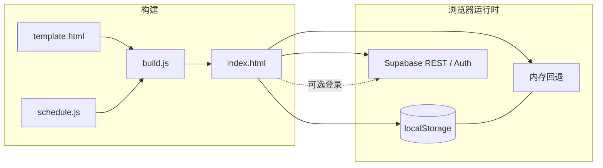

# 接种簿 · 儿童疫苗记录

离线可用的单页 Web 应用，帮助家长查阅国家免疫规划疫苗与常见自费疫苗的推荐程序、记录已接种剂次，并推算下一针时间。**仅供参考，不构成医疗建议**；具体接种请以当地接种门诊、医生意见及疫苗说明书为准。

**在线站点：** [https://hi-vic-vic.github.io/yimiaojilu/](https://hi-vic-vic.github.io/yimiaojilu/)

---

## 功能概览

| 能力 | 说明 |
|------|------|
| **免疫规划（免费）疫苗** | 按《国家免疫规划疫苗儿童免疫程序及说明（2026 年版）》等来源整理程序，展示各剂推荐月龄、间隔与补种提示 |
| **非免疫规划（自费）疫苗** | 勾选后才纳入提醒；程序因产品而异处标注「以说明书为准」 |
| **五联疫苗覆盖** | 记录 DTaP-IPV/Hib 五联后，对应剂次的百白破、脊灰、Hib 自动计为已覆盖，不再单独提醒（如 6 周岁第 5 剂百白破等仍按规则单独提醒） |
| **轮状病毒二选一** | 三价口服轮状（rv3）与五价轮状（rv5）互斥选择，避免重复计划 |
| **下一针推荐** | 结合出生日期、已录剂次、最小间隔与超龄规则，在概览页突出「下一针」，并支持导出 `.ics` 日历提醒 |
| **本机存储** | 默认使用 `localStorage`；无法持久化时回退到内存并提示导出备份 |
| **导入 / 导出** | 支持单孩子「档案」JSON、多孩子完整备份，以及多种格式自动识别导入（见下文） |
| **可选云同步** | 邮箱登录后，经 Supabase 在多设备间同步整份应用状态（见下文） |

### 数据来源（程序内置引用）

- 《国家免疫规划疫苗儿童免疫程序及说明（2026 年版）》（2026 年 6 月，中国疾病预防控制中心发布）
- 国家疾控局等《关于国家免疫规划百白破疫苗和白破疫苗免疫程序调整相关工作的通知》（国疾控卫免发〔2024〕20 号，2025 年 1 月 1 日起实施）
- 原《2021 年版》（国卫疾控发〔2021〕10 号）
- 非免疫规划疫苗依据各产品说明书
- **曼海欣（ACYW135 群脑膜炎球菌多糖结合疫苗，CRM197 载体）**：NMPA 批准说明书（适用年龄 3 月龄～6 周岁/83 月龄，见上海市 GPO 2026-03-05 扩龄说明）；程序摘要亦见《广东省非免疫规划疫苗接种方案（2026 年版）》
- **MCV4 与免疫规划流脑替代关系**：《国家免疫规划疫苗儿童免疫程序及说明（2026 年版）》流脑疫苗“其他事项”第 5–6 条（＜24 月龄按结合疫苗说明书完成规定剂次视为完成 MPSV-A；3 周岁/6 周岁程序年龄接种含 A、C 群成分疫苗视为完成相应 MPSV-AC 剂次）

### 免责声明

本工具仅作信息整理与个人记录辅助，**不能替代**临床判断。接种种类、时间、费用、禁忌与补种方案以当地疾控与接种单位规定为准；如有疑问请咨询专业医务人员。

---

## 架构

单文件静态站点：**无自建后端、无 CDN 外部脚本**。构建时将 `schedule.js`（疫苗数据与排程逻辑）内联进 `template.html`，生成自包含的 `index.html`。



- **未登录**：读写 `localStorage`（键 `vt_data_v1`），逻辑与 PR 前一致。
- **已登录**：通过原生 `fetch` 调用 Supabase Auth（magic link / 6 位验证码、token 刷新）与 PostgREST（`vaccine_data` 行 upsert），**不使用** supabase-js 或第三方 CDN。

---

## 部署

| 项目 | 说明 |
|------|------|
| **托管** | [GitHub Pages](https://pages.github.com/) |
| **工作流** | [`.github/workflows/pages.yml`](.github/workflows/pages.yml) |
| **Actions 运行记录** | [https://github.com/hi-vic-vic/yimiaojilu/actions](https://github.com/hi-vic-vic/yimiaojilu/actions) |

**原则：**

1. 对 `main` 的 **pull request** 与 **push** 均运行 `node test.js`。
2. 仅当 **push 到 `main`** 且测试通过后： `configure-pages`（含 enablement）→ `upload-pages-artifact`（站点内容为 `index.html`）→ `deploy-pages`。
3. 每次合并到 `main` 会自动重新部署 Pages。

**仓库设置（首次或若部署未生效）：**

在 **Settings → Pages → Build and deployment → Source** 选择 **GitHub Actions**（不要选 “Deploy from a branch”）。工作流会尝试 `enablement: true`，若 Source 仍为分支部署，需手动改为 GitHub Actions。

---

## Supabase 云同步（可选）

| 项目 | 值 |
|------|-----|
| **项目 URL** | `https://hdvcfesguugxfapurfif.supabase.co` |
| **区域** | Singapore（新加坡） |
| **认证** | 邮箱 magic link 或邮件中的 **6 位验证码**（`/auth/v1/otp`、`/auth/v1/verify`） |
| **数据表** | `public.vaccine_data`（`user_id` 主键，`data` jsonb 存整份应用状态） |

### 数据库与 RLS

在 Supabase **SQL Editor** 中执行（若表已存在可跳过建表，仅核对策略）：

```sql
create table if not exists public.vaccine_data (
  user_id uuid primary key references auth.users (id) on delete cascade,
  data jsonb not null default '{}'::jsonb,
  updated_at timestamptz not null default now()
);

alter table public.vaccine_data enable row level security;

create policy "vaccine_data_own_row" on public.vaccine_data
  for all
  using (auth.uid() = user_id)
  with check (auth.uid() = user_id);
```

### 密钥与安全

- 前端使用的 **anon（公开）key** 按设计可写在 `schedule.js` 并随 `index.html` 发布；在 **RLS 已正确配置** 的前提下，匿名用户无法读写他人数据，也无法绕过策略批量访问。
- **切勿** 将 **service_role** key、**Resend API key** 或其它 SMTP 密码写入仓库或前端；这些密钥只应保存在 Supabase 控制台或 Resend 控制台。

### Authentication → URL configuration（必填）

| 字段 | 建议值 |
|------|--------|
| **Site URL** | `https://hi-vic-vic.github.io/yimiaojilu/` |
| **Redirect URLs** | `https://hi-vic-vic.github.io/yimiaojilu/**`（本地调试可加 `http://localhost:**`） |

Magic link 登录后会跳回当前站点，应用从 URL hash 解析 `access_token` / `refresh_token`。

### 发信：Resend 自定义 SMTP（当前配置）

本项目通过 [Resend](https://resend.com/) 作为 Supabase Auth 的自定义 SMTP，用于 magic link 与 OTP 邮件。**Resend API key 仅填写在 Supabase 中，不会也不应出现在本仓库。**

在 Supabase **Project Settings → Authentication → SMTP Settings** 中配置：

| 项 | 值 |
|----|-----|
| **Enable custom SMTP** | 开启 |
| **Host** | `smtp.resend.com` |
| **Port** | `465` |
| **Username** | `resend` |
| **Password** | 你的 Resend API key（以 `re_` 开头） |
| **Sender email** | 已在 Resend 中验证的发件地址（域名需在 Resend 完成 DNS 验证） |

随后在 **Authentication → Rate Limits** 中适当提高 **Email sent per hour**（在 Resend 与 Supabase 两侧限额内按需调整）。

**未配置自定义 SMTP 时**：Supabase 内置邮差仅适合极少量测试（约每小时数封且常限制为项目成员），多人使用或频繁登录会很快触达 `over_email_send_rate_limit`。**上述限制仅适用于未启用自定义 SMTP 的情况。**

**Resend 免费档**：通常提供每日/每月发送量上限（具体以 Resend 官网与控制台为准）；超出后需升级套餐或等待额度重置。生产环境请同时关注 Resend 与 Supabase 两侧的速率限制。

### 邮件模板与登录排查

- 若使用 **6 位 OTP**，请在 **Authentication → Email Templates** 正文中包含 **`{{ .Token }}`**，否则用户无法看到验证码。
- Magic link 为一次性链接；请使用最新邮件中的链接。企业邮件安全扫描可能提前消耗链接。
- 前端通过 `/auth/v1/otp?redirect_to=...` 传递回跳地址，Redirect URL 须包含 `/yimiaojilu/` 路径。
- 可使用 `node auth-test.js` 检查 REST 回跳参数与错误提示（无需实际发信）。

---

## 导入与导出

侧栏 **工具** 区提供两种导出方式；**导入备份** 会自动识别文件格式。

| 操作 | 说明 |
|------|------|
| **导出档案** | 仅当前选中孩子，单档案 JSON（可与其它工具互通） |
| **导出备份** | 整份应用状态 `{ children, cur }`，含所有孩子 |
| **导入备份** | 见下方支持的三种格式 |

### 单孩子档案格式（「导出档案」）

```json
{
  "profile": {
    "name": "浔宝",
    "birth": "2026-05-11",
    "sex": "boy",
    "je": "live",
    "hepa": "live",
    "id": "baby-f61df079ea8b",
    "addons": ["pentavalent", "rotavirus3"]
  },
  "records": {
    "bcg-1": { "date": "2026-05-11", "clinic": "", "note": "" },
    "hepb-1": { "date": "2026-05-11", "clinic": "", "note": "" },
    "penta-1": { "date": "2026-07-22", "clinic": "", "note": "" },
    "rota3-1": { "date": "2026-08-05", "clinic": "", "note": "" }
  },
  "exportedAt": "2026-10-12T07:29:56.743Z"
}
```

- **`profile.addons`**：自费项标识（如 `pentavalent` → 五联、`rotavirus3` → 三价轮状）。
- **`records`**：键为 `{疫苗简称}-{剂次}`（1 起），如 `penta-2`、`rota3-3`；未知剂次或非法日期会**跳过**并在浏览器控制台给出警告。
- 完整样例见仓库 [`test/fixtures/xunbao-export.json`](test/fixtures/xunbao-export.json)。

### 导入时接受的格式

1. **完整备份**：`{ "children": [...], "cur": "..." }` — 与「导出备份」一致，**整份替换**当前本机/云同步状态。
2. **单孩子档案**：上表 `{ profile, records, exportedAt }` — 合并进现有状态。
3. **档案数组**：`[ { profile, records, ... }, ... ]` — 按顺序逐个导入。

### 冲突处理（单孩子 / 数组）

若 `profile.id` 与已有孩子相同，会提示选择：

- **覆盖**：用导入数据替换该孩子的资料与全部接种记录。
- **合并**：保留已有记录，仅追加导入中 **疫苗 ID + 日期** 不重复的条目，并合并自费勾选等信息。

导入成功后会选中刚导入的孩子；若已登录云同步，会自动 debounce 上传。

---

## 本地开发

```bash
# 从 template + schedule 重新生成 index.html
node build.js

# 单元测试（排程、五联覆盖、云同步合并逻辑等）
node test.js

# 浏览器端到端（需本机 Chrome）
npm install
node e2e.js
```

本地预览建议用 HTTP 服务打开 `index.html`（例如 `python3 -m http.server`），避免部分浏览器对 `file://` 的限制。云同步 Redirect URL 若需本地 magic link，请在 Supabase 中追加对应 origin。

---

## 项目结构

| 路径 | 说明 |
|------|------|
| `index.html` | **构建产物**：单文件离线应用（提交到仓库供 Pages 部署） |
| `template.html` | 页面结构、样式与 UI 脚本（含 Supabase `fetch` 同步） |
| `schedule.js` | 疫苗程序数据、下一针/时间轴/ICS 逻辑及可单测的同步辅助函数 |
| `build.js` | `node build.js`：将 `schedule.js` 内联替换 `template.html` 中的占位符 |
| `test.js` | Node 单元测试（含档案导入样例） |
| `test/fixtures/` | 导入格式样例 JSON |
| `auth-test.js` | Auth REST / 回跳参数检查（不发信） |
| `e2e.js` | Puppeteer 端到端测试（系统 Chrome） |
| `shots.js` / `repro.js` | 截图与复现辅助脚本 |
| `package.json` | 依赖（主要为 `puppeteer-core`，仅开发/测试用） |
| `.github/workflows/pages.yml` | CI 测试与 GitHub Pages 部署 |

---

## 许可证

见仓库根目录；使用与传播数据内容时请继续遵守上述官方免疫程序文件的效力与更新。
