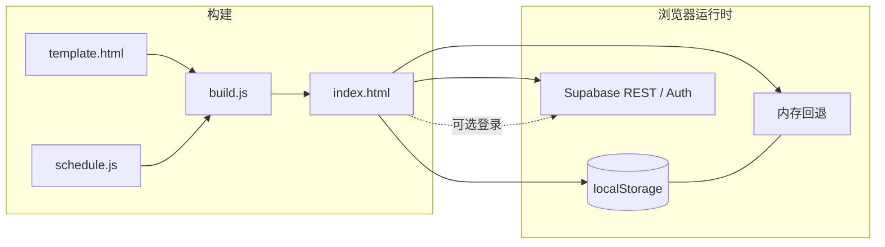

# 接种簿 · 儿童疫苗记录

离线可用的单页 Web 应用，帮助家长查阅国家免疫规划疫苗与常见自费疫苗的推荐程序、记录已接种剂次，并推算下一针时间。**仅供参考，不构成医疗建议**；具体接种请以当地接种门诊、医生意见及疫苗说明书为准。

**在线站点：** [https://hi-vic-vic.github.io/yimiaojilu/](https://hi-vic-vic.github.io/yimiaojilu/)

---

## 功能概览

| 能力 | 说明 |
|------|------|
| **免疫规划（免费）疫苗** | 按《国家免疫规划疫苗儿童免疫程序及说明（2026 年版）》等来源整理程序，展示各剂推荐月龄、间隔与补种提示 |
| **非免疫规划（自费）疫苗** | 勾选后才纳入提醒；程序因产品而异处标注「以说明书为准」 |
| **五联疫苗覆盖** | 记录 DTaP-IPV/Hib 五联后，对应剂次的百白破、脊灰、Hib 自动计为已覆盖，不再单独提醒（如 6 周岁第 5 剂百白破等仍按规则单独提醒） |
| **轮状病毒二选一** | 三价口服轮状（rv3）与五价轮状（rv5）互斥选择，避免重复计划 |
| **下一针推荐** | 结合出生日期、已录剂次、最小间隔与超龄规则，在概览页突出「下一针」，并支持导出 `.ics` 日历提醒 |
| **本机存储** | 默认使用 `localStorage`；无法持久化时回退到内存并提示导出备份 |
| **可选云同步** | 邮箱登录后，经 Supabase 在多设备间同步整份应用状态（见下文） |

### 数据来源（程序内置引用）

- 《国家免疫规划疫苗儿童免疫程序及说明（2026 年版）》（2026 年 6 月，中国疾病预防控制中心发布）
- 国家疾控局等《关于国家免疫规划百白破疫苗和白破疫苗免疫程序调整相关工作的通知》（国疾控卫免发〔2024〕20 号，2025 年 1 月 1 日起实施）
- 原《2021 年版》（国卫疾控发〔2021〕10 号）
- 非免疫规划疫苗依据各产品说明书

### 免责声明

本工具仅作信息整理与个人记录辅助，**不能替代**临床判断。接种种类、时间、费用、禁忌与补种方案以当地疾控与接种单位规定为准；如有疑问请咨询专业医务人员。

---

## 架构

单文件静态站点：**无自建后端、无 CDN 外部脚本**。构建时将 `schedule.js`（疫苗数据与排程逻辑）内联进 `template.html`，生成自包含的 `index.html`。



- **未登录**：读写 `localStorage`（键 `vt_data_v1`），逻辑与 PR 前一致。
- **已登录**：通过原生 `fetch` 调用 Supabase Auth（magic link / 6 位验证码、token 刷新）与 PostgREST（`vaccine_data` 行 upsert），**不使用** supabase-js 或第三方 CDN。

---

## 部署

| 项目 | 说明 |
|------|------|
| **托管** | [GitHub Pages](https://pages.github.com/) |
| **工作流** | [`.github/workflows/pages.yml`](.github/workflows/pages.yml) |
| **Actions 运行记录** | [https://github.com/hi-vic-vic/yimiaojilu/actions](https://github.com/hi-vic-vic/yimiaojilu/actions) |

**原则：**

1. 对 `main` 的 **pull request** 与 **push** 均运行 `node test.js`。
2. 仅当 **push 到 `main`** 且测试通过后： `configure-pages`（含 enablement）→ `upload-pages-artifact`（站点内容为 `index.html`）→ `deploy-pages`。
3. 每次合并到 `main` 会自动重新部署 Pages。

**仓库设置（首次或若部署未生效）：**

在 **Settings → Pages → Build and deployment → Source** 选择 **GitHub Actions**（不要选 “Deploy from a branch”）。工作流会尝试 `enablement: true`，若 Source 仍为分支部署，需手动改为 GitHub Actions。

---

## Supabase 云同步（可选）

| 项目 | 值 |
|------|-----|
| **项目 URL** | `https://hdvcfesguugxfapurfif.supabase.co` |
| **区域** | Singapore（新加坡） |
| **认证** | 邮箱 magic link 或邮件中的 **6 位验证码**（`/auth/v1/otp`、`/auth/v1/verify`） |
| **数据表** | `public.vaccine_data`（`user_id` 主键，`data` jsonb 存整份应用状态） |

### 数据库与 RLS

在 Supabase **SQL Editor** 中执行（若表已存在可跳过建表，仅核对策略）：

```sql
create table if not exists public.vaccine_data (
  user_id uuid primary key references auth.users (id) on delete cascade,
  data jsonb not null default '{}'::jsonb,
  updated_at timestamptz not null default now()
);

alter table public.vaccine_data enable row level security;

create policy "vaccine_data_own_row" on public.vaccine_data
  for all
  using (auth.uid() = user_id)
  with check (auth.uid() = user_id);
```

### 密钥与安全

- 前端使用的 **anon（公开）key**  deliberately 可写在 `schedule.js` 并随 `index.html` 发布；在 **RLS 已正确配置** 的前提下，匿名用户无法读写他人数据，也无法绕过策略批量访问。
- **切勿** 将 **service_role** key 写入仓库或前端；该密钥仅用于受信任的服务端环境。

### Authentication → URL configuration（必填）

| 字段 | 建议值 |
|------|--------|
| **Site URL** | `https://hi-vic-vic.github.io/yimiaojilu/` |
| **Redirect URLs** | `https://hi-vic-vic.github.io/yimiaojilu/**`（本地调试可加 `http://localhost:**`） |

Magic link 登录后会跳回当前站点，应用从 URL hash 解析 `access_token` / `refresh_token`。

### 邮件与验证码模板

- Supabase **内置 SMTP** 有速率限制（约 **每小时少量邮件**），开发或多人测试时可能触达上限。
- 可在 **Project Settings → Authentication → SMTP** 配置自定义 SMTP（例如 [Resend](https://resend.com/)）以提高配额与送达率。
- 若使用 **6 位 OTP**，请在 **Authentication → Email Templates** 的邮件正文中包含验证码占位符 **`{{ .Token }}`**，否则用户收不到可输入的验证码。

---

## 本地开发

```bash
# 从 template + schedule 重新生成 index.html
node build.js

# 单元测试（排程、五联覆盖、云同步合并逻辑等）
node test.js

# 浏览器端到端（需本机 Chrome）
npm install
node e2e.js
```

本地预览建议用 HTTP 服务打开 `index.html`（例如 `python3 -m http.server`），避免部分浏览器对 `file://` 的限制。云同步 Redirect URL 若需本地 magic link，请在 Supabase 中追加对应 origin。

---

## 项目结构

| 路径 | 说明 |
|------|------|
| `index.html` | **构建产物**：单文件离线应用（提交到仓库供 Pages 部署） |
| `template.html` | 页面结构、样式与 UI 脚本（含 Supabase `fetch` 同步） |
| `schedule.js` | 疫苗程序数据、下一针/时间轴/ICS 逻辑及可单测的同步辅助函数 |
| `build.js` | `node build.js`：将 `schedule.js` 内联替换 `template.html` 中的占位符 |
| `test.js` | Node 单元测试 |
| `e2e.js` | Puppeteer 端到端测试（系统 Chrome） |
| `shots.js` / `repro.js` | 截图与复现辅助脚本 |
| `package.json` | 依赖（主要为 `puppeteer-core`，仅开发/测试用） |
| `.github/workflows/pages.yml` | CI 测试与 GitHub Pages 部署 |

---

## 许可证

见仓库根目录；使用与传播数据内容时请继续遵守上述官方免疫程序文件的效力与更新。
